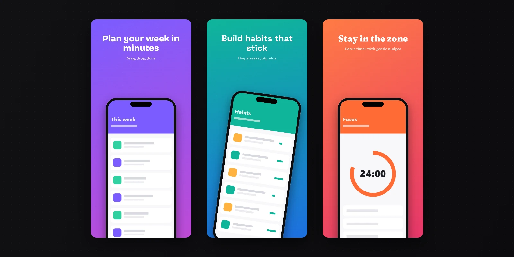

# Huzairul Shazmey

**Software Developer** · Malaysia 🇲🇾

I build tools that make developers and creators faster: browser apps, extensions, and AI-powered utilities.

---

## 🚀 Featured projects

### [PageBridge](https://pagebridge-five.vercel.app) · [repo](https://github.com/huzairulshazmey/pagebridge)

Turn a design export into a WordPress page. Drop the ZIP from Claude Design (or any HTML/CSS/JS site) and get one Custom HTML block to paste into the WordPress editor, a single self-contained HTML file, or embed code for page builders. Keep forms and video working, or export a lighter design-only copy. Runs entirely in your browser; your files never leave your computer.

**[▶ Try it live](https://pagebridge-five.vercel.app)**

### [Showglass](https://github.com/huzairulshazmey/showglass)

App Store & Google Play screenshot studio that runs entirely in your browser. Multi-slide projects, device frames, backgrounds picked from your app's own colours, headlines that auto-fit every language, and a preview of how your slides look in store search. Export everything as one ZIP.

### [Element Picker](https://github.com/huzairulshazmey/element-picker-extension)

Chrome extension: hover any element on a page and copy its HTML in one click.

---

## 🧰 Stack

📊 GitHub stats

 

